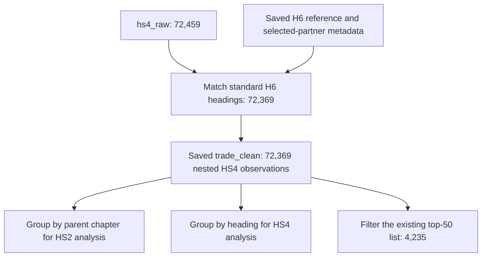

# MongoDB Personal Project Plan

## Project goal

Build a reproducible Jupyter Notebook that downloads public data, loads it into MongoDB, cleans and models it, and answers interesting questions using aggregation pipelines.

**Approach:** follow the course template and use beginner-friendly Python and PyMongo syntax.

**Nested sets:** optional. Decide after inspecting the dataset, rather than choosing data only to force this technique.

### Current status and scope

Status below reflects saved notebook outputs and local snapshots, not a new live database check.
Keep completed phases in this plan as evidence of the work.

| Phase | Status | Evidence or remaining work |
|---|---|---|
| Dataset selection | Done | UN Comtrade, Swiss annual exports, original H6 classification |
| Notebook and PDF setup | Partial | Quarto settings and a 42-page draft PDF exist; final report structure and layout need review |
| Python and Atlas setup | Core done | Successful saved `ping`; environment/version record remains open |
| Partner discovery and raw loading | Done | 673 records in the snapshot and verified raw collection |
| Top-30 partner selection | Done | MongoDB ranking across 2023-2025; retain code 490 with its official label |
| HS4 extraction and raw loading | Done | 90 completed batches, no empty batches, 72,459 verified raw documents |
| Reference and coverage checks | Initial checks done | 90 nonstandard `9999` rows remain raw; source sums reconcile within rounding |
| Top-50 heading selection | Done | MongoDB ranking; 4,235 observed combinations, not 4,500 actual records |
| MongoDB data quality checks, transformation, and save | Done | Saved outputs confirm 72,369 clean documents and successful saved-collection checks |
| Research analysis and submission | In progress | Three executed analyses, interpretations, conclusions, and learnings exist; final review, reproducibility, PDF, and packaging remain open |

**Scope clarification:** this project studies export destinations, not imports or total two-way trade.
Use "partner areas" because the source includes territories and statistical categories.

**Modeling decision:** keep all standard HS4 detail for the selected 30 partners in the main clean collection.
Keep the completed top-50 selection as a focused analytical subset, not the only source for HS2 totals.
A heading can matter to one partner without appearing in the overall top 50.

**Updated source decision:** use only existing HS4 detail for the remaining modeling and research steps.
The saved HS4 snapshot also supplies the H6 reference and frozen partner selection.
No additional API extraction or partner-total clean collection is required.

### What the existing raw collections contain

| Collection | Actual commodity level | Partner scope | Role from now on |
|---|---|---|---|
| `partner_totals_raw` | `TOTAL`, not HS2 chapters | All returned partners, including World | Keep as completed discovery evidence; do not extend its modeling |
| `hs4_raw` | All returned four-digit source detail, not only the top 50 | The selected 30 partner areas | Sole observation source for the remaining work |

`partner_totals_raw` cannot supply a product breakdown because each row combines all commodities.
The top-50 result is a later filter of `hs4_raw`, not the complete contents of that collection.
Obtain HS2 chapter values by grouping standard HS4 observations under their two-digit parent codes.

The current snapshot supports these distinct scopes:

| Dataset or subset | Observations | Purpose |
|---|---:|---|
| All-partner annual totals | 673 | Completed partner selection and historical coverage evidence only |
| Raw HS4 detail for 30 partners | 72,459 | Preserve all returned source rows, including `9999` |
| Standard HS4 detail for 30 partners | 72,369 | Saved and verified main product-analysis clean collection |
| Top-50 HS4 subset | 4,235 | Focused comparisons and continuity with the completed selection |

The standard detail covers 1,223 observed HS4 headings across 96 HS2 chapters.
These are observations within the selected partners, not complete World-by-product totals.
Future partner shares therefore describe the selected HS4 dataset, not a share of all Swiss exports.

Current evidence uses these frozen files:

- Completed discovery evidence: `data/v2_partner_totals_20261016T143600945247Z.json`.
- Main remaining-work input: `data/v2_hs4_snapshot_20261017T094752738553Z.json`, including its H6 reference.
- Execution and loading evidence: `UN_Comtrade_V2.ipynb` and its Atlas screenshot.

Recompute expected counts if a later extraction replaces this analytical snapshot.

### Course reference rule for future AI assistance

**If unsure about course-related syntax, coding style, data modeling, operators, or an implementation approach—or if earlier conversation context has been forgotten—read the relevant sections of [Copy_paste_course_content.md](txt%20course%20content/Copy_paste_course_content.md) before proposing or writing code. Do not rely on memory or assume what the course teaches.**

- The notes are stored at `txt course content/Copy_paste_course_content.md`, relative to this project folder.
- Start with the relevant topic heading, such as Data Model Design, Updating Collection Structure, Query an Array of Embedded Documents, Query for Null or Missing Fields, or Tree Structures.
- Prefer the course’s simple Python/PyMongo patterns and explain both the syntax and the logic at a beginner level.
- Distinguish mongosh examples from Python examples; translate syntax correctly rather than copying JavaScript directly into the notebook.
- The course is the starting point, not a restriction. Use additional techniques when they genuinely help, and explain why they are needed and how they relate to the course.
- If an example is outdated, ambiguous, or incorrect, verify the behavior in current official documentation and explain the correction instead of reproducing it blindly.
- Follow the assignment requirements when choosing scope; a topic appearing in the notes does not make it compulsory.

### Requirements versus learning goals

- **Assignment requirements:** scripted download of public, free, non-Kaggle data; loading into a MongoDB cluster from a notebook; modeling and cleaning in MongoDB; in-depth aggregation analysis; at least two images including a class diagram; PDF and notebook submission with images in a ZIP.
- **Assignment recommendation:** try to use at least four aggregation pipelines, counting transformation, cleaning, and analysis pipelines.
- **Suggested scope, not extra requirements:** 3–4 research questions and around 5–6 meaningful pipelines overall. Adjust these to the dataset; depth and clear reasoning matter more than an arbitrary count.
- **Optional extensions:** multiple sources, nested sets, geospatial analysis, text search, and a small indexing demonstration. Do not attempt all of them.

The three grading areas have equal weight: PDF quality, transformation complexity, and aggregation sophistication. The project contributes 80% of the NoSQL Lab grade.

---

## 1. Find and evaluate a dataset

- [ ] Shortlist 2–3 topics you find interesting. Historical planning suggestion; no retrospective shortlist is necessary now.
- [x] Find public, free data available through an API or downloadable file URL.
- [x] Exclude Kaggle datasets.
- [x] Test a small download before committing to a source.
- [x] Inspect a few records and the API documentation.

### Dataset selection checklist

| Check | What to look for |
|---|---|
| Access | Free access, manageable authentication and rate limits |
| Format | Prefer JSON with nested objects or arrays |
| Questions | Enough information for 3–4 meaningful research questions |
| Cleaning | Opportunities to handle missing values, types, duplicates, or inconsistent structures |
| Scope | A manageable download, not necessarily a large dataset |
| Documentation | Understandable fields, units, dates, and identifiers |
| Hierarchy | A genuine category tree, if considering nested sets |

- [x] Review the source’s usage terms and attribution requirements. Recheck the applicable terms before sharing raw data.
- [x] Define a bounded scope, such as a date range, region, or category, and explain its limitations.

**Output (completed):** UN Comtrade was selected for its documented public API and useful annual trade measures. The V1 bounded scope is Switzerland’s 2022–2025 exports to World by HS chapter, with four research questions recorded in the notebook.

**V2 extraction and selection (done):** `UN_Comtrade_V2.ipynb` contains Switzerland's 2023-2025 partner discovery and HS4 extraction.
The notebook ranks 30 partner areas and 50 HS4 headings through MongoDB aggregation.
It preserves V1 as the separate World-by-chapter baseline for 2022-2025.
Other reporting dimensions retain their aggregate selections.

**Next modeling scope:** preserve the completed top-50 result, but build the main clean product collection from all standard HS4 rows.
This supports meaningful HS2 chapter totals and partner-specific HS4 rankings without global-top-50 truncation.

---

## 2. Create the notebook structure

Follow the assignment template:

```text
1 Summary
2 Requirements & Configuration
3 ELT Process
  3.1 Database Setup
  3.2 Extract
  3.3 Load
  3.4 Transform and Data Quality
  3.5 Data Structure
4 Data Analysis
  4.1 Research Question 1
  4.2 Research Question 2
  4.3 Research Question 3
5 Conclusions
6 Learnings
7 Sources
```

- [x] Use numbered headings and a table of contents. Quarto supplies automatic numbering and a table of contents.
- [ ] Write brief Markdown explanations before code.
- [x] Test PDF export early with a table and an image. A V2 draft PDF exists; final readability checks remain open.

**Practical focus:** clear communication matters as much as technical work; PDF quality contributes one-third of the project grade.

The template’s older Jupyter extensions and PDF instructions may not match the installed environment. Test an available export method before relying on them.

### PDF workflow: try Quarto first

The assignment lists Quarto as an option, not a requirement. Our intended workflow is:

**Write and execute the Jupyter Notebook → Save its outputs → Render with Quarto → Inspect the PDF**

- [x] Check whether Quarto is installed; it is a separate publishing tool, not included automatically with Jupyter.
- [x] For Quarto’s standard LaTeX PDF workflow, check for a working TeX installation. Quarto and LuaLaTeX are available.
- [x] Test a small notebook containing a heading, paragraph, aggregation result table, and local image before formatting the whole project. The existing V2 draft provides this early render test; no separate miniature notebook is necessary.
- [ ] Configure the title, author, table of contents, and section numbering in notebook-level Quarto metadata. Only author information remains absent.
- [x] Use either automatic section numbering or manually numbered headings, not both. The notebook uses automatic numbering.
- [ ] Keep selected aggregation code visible where it helps demonstrate the work; hide setup or verbose download code from the PDF if useful. Keep all required code in the submitted notebook.
- [ ] Check table rendering early. Wide Pandas tables may need fewer columns, shorter labels, or an export-friendly representation.

Once the real notebook filename is chosen, the basic render command is:

```bash
quarto render "project.ipynb" --to pdf
```

`project.ipynb` is a placeholder. Quarto normally uses saved outputs when rendering an existing notebook unless execution is requested. Restart the kernel, run all cells successfully, and save before the final render; avoid accidentally rerunning API downloads or database writes through an additional execution step.

**Fallback:** if Quarto setup or layout becomes a distraction, use the assignment’s browser **Print → Save as PDF** approach. Check print preview, headings, tables, images, and unnecessary interface elements. Quarto does not replace the requirement to submit the notebook and images.

---

## 3. Configure Python and MongoDB

- [x] Use the course’s main packages: `requests`, `pymongo`, and `pandas`.
- [x] Add other packages only when needed. Current additions support configuration, Atlas DNS, notebook execution, or the separate India workbook.
- [x] Keep API settings and database names together.
- [x] Read database credentials from outside the notebook, such as an environment variable.
- [x] Connect to the MongoDB cluster and verify the connection with `client.admin.command("ping")`; creating `MongoClient` alone does not prove the connection works.
- [x] Select clearly named project collections.
- [ ] Record the Python, package, and MongoDB server versions used.

### Current collection structure

```text
swiss_trade_v2
  partner_totals_raw     keep: 673 historical all-commodity observations
  hs4_raw                current: 72,459 source observations
  trade_clean            saved and verified: 72,369 standard HS4 observations
```

The earlier `partner_totals_clean` proposal is superseded, not completed.
Do not implement it under the updated HS4-only scope.
The top-50 subset remains a query/view of the main clean detail, not a replacement for that detail.
Add a separate reference collection only if chapter-description enrichment genuinely needs it.

**Course concepts:** `MongoClient`, databases, collections, documents, and `_id`.

Raw and clean collections are a recommended design, not a requirement. Select the database and collections before loading, but make the main modeling decisions after inspecting sample data. Selecting `client[DB_NAME]` alone does not create a stored database.

**Output:** a working connection without credentials appearing in code, outputs, or the submitted ZIP.

---

## 4. Extract data using notebook code

**Request → Check response → Parse JSON → Inspect → Repeat if needed**

- [x] Start with one small request.
- [x] Check HTTP errors before parsing the response.
- [x] Use a request timeout.
- [x] Handle pagination if the API returns batches. Use bounded partner-year requests and stop at the record cap instead of accepting truncation.
- [x] Respect rate limits. Data batches use delays and bounded timeout/rate-limit retries.
- [x] Verify the returned JSON structure and stop with a clear error if an expected field is absent.
- [x] Record the source, download date, filters, and coverage.
- [x] Inspect nested objects, arrays, and source identifiers. Snapshot containers contain flat source observations.

**Coding style:** simple loops, clear variable names, and small functions where they avoid repetition.

**Output:** downloaded records with a documented scope.

**Completed evidence:** the HS4 snapshot contains 72,459 rows from 90 complete batches, with no empty batches.
It also stores the H6 reference, partner selection, request logs, and all-commodity control totals.
Coverage checks distinguish all source rows from standard headings and preserve missing combinations.

---

## 5. Load the raw data into MongoDB

- [x] Preserve the source fields with minimal changes. Add only stable MongoDB `_id` values.
- [x] Load records using `insert_many()` or another suitable PyMongo operation. Use replacement/upsert operations and bounded HS4 bulk batches.
- [x] Check the inserted document count. Saved verification shows 673 partner totals and 72,459 HS4 documents.
- [ ] Inspect sample documents using `find_one()` and limited `find()` queries. Atlas screenshot inspection is complete; add a notebook query example.
- [x] Decide how repeated notebook runs will avoid accidental duplicate imports.

Choose a simple rerun policy before the first full import. For example, use stable source IDs with `replace_one(..., upsert=True)` so the same records are replaced rather than appended. This is a modest extension of the course’s replacement/upsert examples. It does not remove records that disappear from the source, so distinguish an incremental refresh from a complete snapshot.

For larger downloads, load manageable batches. Avoid putting the entire dataset into one document; MongoDB has a 16 MiB document-size limit.

**Course concepts:**

- Python dictionaries → BSON documents.
- Python lists → arrays.
- Unique `_id` values.
- `insert_many()`, `find_one()`, `find()`, and `count_documents()`.

**Important:** do not use `drop()` or `delete_many({})` as an unexplained automatic reset.

**Output:** a raw collection that can be checked against the downloaded data.

**Completed selection phases:**

- [x] Rank the top 30 non-World partner areas by cumulative 2023-2025 all-commodity export value.
- [x] Retain code `490`, `Other Asia, nes`, under the documented partner-area scope.
- [x] Download their HS4 detail, validate H6 membership, and preserve nonstandard source rows.
- [x] Rank the top 50 standard headings across the selected partners and years in MongoDB.
- [x] Check the current top-50 observation count: 4,235.

Keep these results as completed work even though the next clean model retains wider product coverage.

---

## 6. Check data quality and transform the data inside MongoDB

**Status: data quality checks, data transformation, saving, and saved-collection verification complete.**
Saved MongoDB results confirm 72,459 raw documents, including 72,369 standard HS4 observations and 90 `9999` observations.
The checks find no out-of-scope documents or duplicate observation groups.
The user's existing connection and data quality execution flags remain enabled and unchanged.
The user enabled `PREVIEW_TRADE_CLEAN = True` and saved successful preview and full-result check outputs.
The three-stage transformation follows the agreed mapping and preserves source values and BSON types.
The checks cover all 72,369 standard observations with zero copied-value or BSON-type mismatches.
Standard-heading net weights retain 495 nulls and eight numeric zeros.
The earlier destination check found no `trade_clean` collection before saving.
Later saved outputs confirm creation of `swiss_trade_v2.trade_clean` with all 72,369 standard HS4 observations.
Saved-collection checks passed for yearly counts, identifiers, observation keys, BSON types, nulls, zeros, sums, and preview samples.
The raw verification helper confirmed all 72,459 HS4 raw observations against the frozen snapshot after saving.
Current save settings are `SAVE_TRADE_CLEAN = False` and `VERIFY_TRADE_CLEAN = True`.
The save cell checks the raw snapshot and destination again immediately before `$out`.
It refuses to replace an existing destination.
Successful read-only checks now retain an independent pipeline copy using Python's standard-library `deepcopy`.
The save cell rejects missing copies or later stage changes and saves only the checked copy.
The user reran the updated checks before saving and retained the successful outputs.
This completion record uses saved notebook evidence, not a new assistant-run database operation.
The editable UML source and rendered image record the stored model.
The notebook includes the raw/clean schema screenshots and the UML image.
Final PDF readability review remains pending.

### Completed save and verification evidence

| Saved scope | 2023 | 2024 | 2025 | Total |
|---|---:|---:|---:|---:|
| Standard HS4 observations in `trade_clean` | 23,805 | 24,188 | 24,376 | 72,369 |

- The save used `$out` on the full independent checked pipeline.
- Saved identifiers matched the standard-heading raw identifiers; saved observation keys had no duplicate groups.
- Saved BSON type distributions and embedded objects matched the successful transformation preview.
- Net weights retained 495 nulls and eight numeric zeros.
- Main quantities retained 9,441 numeric zeros; alternative quantities retained 42,939 numeric zeros.
- Primary and FOB sums each matched their source sums within the stated floating-point tolerance.
- Full document comparisons passed for the three preview observations.
- Raw verification confirmed 72,459 unchanged HS4 source documents against the frozen snapshot.
- The 90 nonstandard `9999` observations remain raw only.

Before saving, row-level comparisons covered every directly copied field across all 72,369 standard observations.
After saving, checks covered all identifiers, type distributions, null/zero counts, and monetary sums.
Complete saved-document equality checks covered three preview documents, not every stored document.
Nulls, zeros, and estimation flags retain their source meanings.
The cumulative monetary sums describe 2023–2025 within the selected standard-HS4 dataset, not all Swiss exports.

### 6.1 Choose an embedded observation model

Use the course's **Embedded Data Models** approach from Lecture 5, Data Model Design.
Keep fields describing the same observation together in one small document.
Represent the country-product relationship through observations, not one growing array per country.

Use one base observation grain for the remaining model:

| Saved collection | One document represents | Why retain it |
|---|---|---|
| `trade_clean` | One year, reporter, partner area, HS4 heading, edition, flow, and fixed additional dimensions | Analyze product mixes and changes among the selected 30 partners |

This collection contains all 72,369 standard HS4 observations, not only the top-50 subset.
This scope retains smaller products and supports partner-specific rankings.
HS2 summaries will be aggregation results derived from this same collection.
They do not require a new HS2 download or a second clean base collection.

Embedding repeats some country labels, but it avoids joins for ordinary observation queries.
Keep the original raw `_id` so each clean document can trace back to its source observation.
Keep full extraction provenance in the saved snapshots and notebook sources.



HS2 totals are derived results, not additional HS4 observations.
Never add parent chapter totals to their child-heading values.

### 6.2 Saved fields and their analytical purpose

The readable naming decision was agreed on 17 October 2026.
Keep six embedded objects, with a parent chapter code for HS2 analysis.
The notebook's agreed source-to-clean mapping and UML document every retained field.
The transformation definitions and read-only checks have successful saved MongoDB outputs.
Saving and saved-collection verification have successful saved MongoDB outputs.

| Field or object | Stored contents | Purpose |
|---|---|---|
| `_id` | Existing stable source identifier | Traceability and unique observations |
| `year` | Original `period` string | Compare years without changing the source type |
| `exportingCountry` | `comtradeCode`, `isoCode`, `name` | Identify Switzerland as reporter, not production origin |
| `destinationArea` | `comtradeCode`, `isoCode`, `name` | Preserve partner-area identity and official labels |
| `tradeFlow` | `code`, `description` | Keep export direction explicit |
| `product` | `classificationEdition`, `aggregationLevel`, `hsCode`, `description`, `chapter.hsCode` | Support HS4 detail and HS2 grouping |
| `tradeMeasures` | Primary and FOB values in USD, net weight in kg, main and alternative quantities with units | Preserve measures without mixing units |
| `dataQuality` | Classification, aggregation, reporting, estimation flags, and integer `legacyEstimationFlag` | Support transparent inclusion rules and sensitivity checks |

Saved identifiers, ISO labels, HS codes, and `year` use strings.
Country codes use integer BSON types; decimal measures use doubles, and absent measures retain null.
Quality flags use booleans, except integer `legacyEstimationFlag`; embedded groups use objects rather than arrays.
Verify actual BSON types with MongoDB before finalizing the class diagram.

Keep Comtrade country codes rather than substituting ISO numeric codes.
Preserve `partnerISO` as supplied; statistical partner areas can use nonstandard country identifiers.

Every document in the saved clean collection represents an HS4 observation.
Do not add World or all-commodity summary rows to it.
The completed World-total reconciliation remains historical evidence, not a required input to future analysis.

Store HS codes as strings, including the two-digit parent code.
Derive `product.chapter.hsCode` from the first two digits of the HS4 code inside MongoDB.
`$substrBytes` is a small additional expression; explain it rather than claiming the notes teach it directly.

Use the saved H6 reference for chapter labels.
Initially, label aggregation results for display without recomputing their totals in Python.
Do not store `chapter.description` in the agreed model.
No reference collection or `$lookup` is necessary for this transformation.

Document trade values as current US dollars and net weight as kilograms.
Retain quantity units because different headings can use different units.
Do not add primary value, FOB value, and CIF value together.
Do not convert decimal trade values to integers.

Retain measurement values and their flags together.
Include alternative quantities, both unit identifiers, and their estimation flags.
Keep `tradeMeasures.netWeightKg` nullable and preserve all retained nulls and zeros.
Omit all-null `cifvalue` and all-zero `grossWgt` from clean documents; preserve both fields in raw data.
Retain `dataQuality.isGrossWeightEstimated` with the other source flags despite omitting gross weight.
Do not equate an unestimated flag with proof that every zero represents a measured quantity.
Keep `isReported` and `isAggregate` as source flags, not automatic deletion rules.

### 6.3 Use the course transformation pattern

Follow Lecture 5, **Updating Collection Structure**, and Lecture 6's named-stage Python examples:

| Step | Course-aligned method | Project application |
|---|---|---|
| Filter | `$match` | Keep the selected years, dimensions, partners, and standard heading codes |
| Shape | `$project` | Embed related source fields and deliberately omit unused raw columns |
| Derive | `$addFields` or `$set` | Add the parent chapter code and justified quality indicators |
| Preview | `collection.aggregate(pipeline + [{"$limit": 3}])` | Inspect three results without writing |
| Persist | `$out` to a separate collection | Save the model while preserving raw collections |
| Inspect | `find_one()`, limited `find()`, `count_documents()` | Verify document structure and stored counts |

Use named variables such as `match1`, `project1`, and `add_fields1`, followed by `pipeline = [...]`.
Use quoted operator keys and Python `True`, `False`, and `None`.
Separate stages when one derived field depends on another.
Do not use Python loops to rebuild the clean documents outside MongoDB.

Use the course's nested-object idea, not its destructive exercise resets.
Never run an unexplained `drop()` or `delete_many({})`.
Check destination names and existence before `$out`; it can replace an existing collection.
If a destination already exists, inspect it and choose an unused name or request explicit replacement approval.

### 6.4 Implementation and acceptance checklist

- [x] Agree on readable names and document the source-to-clean mapping and draft UML before implementation.
- [x] Check missing/null values, BSON types, duplicate keys, ranges, and source flags through MongoDB.
- [x] Document actual findings; do not manufacture errors to demonstrate cleaning.
- [x] Implement the agreed named-stage transformation and disabled read-only preview/check cells.
- [x] Preview the full standard-HS4 transformation, including the parent chapter code.
- [x] Verify that `9999` remains raw but does not enter standard-heading analysis.
- [x] Implement a fresh destination-existence check that refuses automatic replacement of `trade_clean`.
- [x] Save the clean collection through MongoDB aggregation with `$out`.
- [x] Confirm identifier uniqueness and row-level copied values before saving.
- [x] Verify stored identifiers, observation keys, types, nulls, zeros, sums, and preview samples.
- [x] Compare raw and clean value sums within the same scope.
- [x] Check that `hs4_raw` retains its original count and contents.
- [ ] Query nested fields with dot notation after persistence.
- [x] Add regression checks for the mapping, scope, counts, and leading-zero preservation.

Verified clean counts and the existing drill-down counts for the frozen HS4 snapshot:

| Scope | 2023 | 2024 | 2025 | Total |
|---|---:|---:|---:|---:|
| Main standard-HS4 clean collection | 23,805 | 24,188 | 24,376 | 72,369 |
| Existing top-50 drill-down | 1,416 | 1,412 | 1,407 | 4,235 |

The 90 excluded raw rows use `9999`; they are not 90 failed API requests.
Keep them available for explaining standard-heading coverage.
The top-50 grid has 4,500 possible combinations, with 265 absent observations.
Neither the main collection nor its drill-down should invent zero-valued combinations.

### Inspect first

- [ ] Count missing and explicit null values.
- [ ] Check field types.
- [ ] Identify duplicate source IDs or other meaningful duplicate keys.
- [ ] Check invalid values, dates, and numeric ranges.
- [ ] Inspect inconsistent category names or units.
- [ ] Define what makes two records duplicates and which record should be retained, such as the most recently updated one.

The extraction already checks source-key uniqueness, scope, and finite nonnegative primary values.
Saved MongoDB checks now cover the raw-data findings above.
The user ran and saved successful full transformed-result checks.
The user also ran and saved successful stored-collection checks after saving.

### Transform only where justified

| Task | Techniques |
|---|---|
| Inspect missing fields | `$exists`, `$type`, queries using `None` |
| Convert numeric strings | `$toInt` for whole numbers; `$convert` to an appropriate numeric type when needed |
| Convert date strings | `$dateFromString`, with explicit format/timezone handling where needed |
| Add derived fields | `$addFields` / `$set` |
| Remove unnecessary fields | `$unset` or `$project` |
| Detect duplicates | `$group`, `$sum`, `$match` |
| Save transformed documents | `$out` to a dedicated clean collection |
| Update stored fields | `update_many()` with an update pipeline |

`$convert` would be a small extension beyond the examples if needed. Explain any additional syntax.

Do not convert decimal measurements or prices to integers: this can discard fractional values. Use a suitable type, such as double for measurements or Decimal128 where exact decimal arithmetic is needed. If conversions fail, count and inspect the failures rather than silently treating them as valid values.

**Before cleaning → Explain the rule → Transform → Check again**

Do not invent errors just to demonstrate cleaning. A check that finds no problems is still useful evidence.

Remember that a query such as `{"field": None}` matches both explicit null values and missing fields. Use `$type` or `$exists` to distinguish them.

Keep the raw collection unchanged. `$out` replaces the destination collection if it already exists, so use a dedicated clean collection deliberately.

Ordinary `aggregate()` results do not modify stored documents. Persist transformations with `$out` or an appropriate update operation. Use separate stages when a calculated field depends on another field created earlier in the pipeline.

The course duplicate-removal example collects IDs using `$addToSet`, whose order is unspecified. Do not assume its first ID is the earliest or best record; use an explicit retention rule.

**Output:** clean data and a compact before/after quality summary.

---

## 7. Explain and visualize the data model

- [x] State what one document represents. Raw and saved clean documents retain the same HS4 observation grain.
- [x] Explain important fields and BSON types.
- [x] Explain which information is embedded and which is referenced.
- [ ] Use dot notation to inspect nested fields and `$elemMatch` where conditions must match the same array element.
- [x] Include a **class diagram** matching the actual cleaned structure.
- [x] Include additional raw/clean document schema screenshots.

### Required and optional diagrams

- [x] Create a UML class diagram matching the implemented clean fields, types, and embedded relationships.
- [x] Show composition for embedded objects; do not imply that each object has its own collection.
- [x] State the HS4 observation grain and distinguish it from derived HS2 summaries.
- [x] Export the UML diagram as an image and include it in the notebook.
- [ ] Include the UML image and required screenshots in the final ZIP.
- [ ] Review all diagram images for readability in the final PDF.
- [x] Add the Atlas screenshot as current raw-loading evidence. It does not replace the required clean-model class diagram.

The assignment requires a class diagram, not both a class diagram and an ERD.
The course describes UML class diagrams as suitable for document databases.
An ERD remains an optional planning sketch.
Use the Chinook examples to learn notation, not to copy their relational schema into this project.

### Included schema and UML images

The notebook uses one compact side-by-side comparison image in a single Markdown cell.
It crops selected schema fields from both original screenshots and removes the surrounding application background.
Gap labels identify omitted rows; the one-sentence caption identifies these views as excerpts.
Both panels have equal width and height, with matching top and bottom edges.
Extra spacing stays within labeled omission bands rather than stretching screenshot text.
The clean excerpt continues through `tradeMeasures` and `year`, and the notebook centers the composite image.
The complete UML remains below the comparison.

- `screenshots/hs4 diagram.png`: supplied raw HS4 schema screenshot, unchanged.
- `screenshots/trade_clean diagram.png`: supplied clean schema screenshot, unchanged.
- `screenshots/raw_clean_schema_comparison.png`: compact cropped comparison used by the notebook.
- `screenshots/trade_clean_uml.png`: rendered UML image used by the notebook.
- `screenshots/trade_clean_uml.svg`: vector version for scalable viewing.

`render_trade_uml.py` reads the existing Mermaid class definitions and composition relationships from V2 without executing notebook cells.
It renders them locally with Matplotlib, an existing project dependency.
The image uses the course's UML attributes, types, composition diamonds, and multiplicity notation.
Only `TradeObservation` represents collection documents; the other boxes represent embedded objects.
Keep `netWeightKg` nullable and chapter metadata limited to `hsCode`.
Regenerate the image after changing its editable UML source:

```bash
python3 render_trade_uml.py
```

`prepare_schema_comparison.py` crops the original screenshots and combines their excerpts without changing either source image.
It uses the installed Pillow image tools and Matplotlib's font lookup.
Regenerate the compact comparison with:

```bash
python3 prepare_schema_comparison.py
```

### Models we do not need to force

Do not create separate reporter and partner collections merely to resemble relational tables.
Use references only when they solve a real metadata-maintenance or reuse need.
Do not add product arrays to each observation just to demonstrate `$unwind` or `$elemMatch`.
Those operators are useful only when a genuine array or analytical result requires them.

No nested-set implementation is planned for V2.
HS4 codes and parent chapter metadata already support the required hierarchy queries.
The optional nested-set notes below remain for reference, not as unfinished compulsory work.

### Optional: nested sets

Only include them if the dataset has a genuine, suitable hierarchy.

**Identify hierarchy → Assign `left`/`right` boundaries → Validate → Query branches → Analyse related records**

Explain both the advantage for branch reads and the difficulty of updates. Distinguish immediate children from all descendants.

Prefer a relatively stable tree. Check `left < right`, unique traversal boundaries, and valid parent/descendant containment. If Python is used to assign traversal numbers, explain that step and still demonstrate meaningful MongoDB transformations and branch analysis. Do not assume nested sets are always faster than other tree models.

Nested sets represent a tree through number ranges. They are different from embedded JSON documents, although both can be used in the same project.

**Output:** two readable images and a justified model—not complexity for its own sake.

---

## 8. Answer research questions with aggregation pipelines

Aim for **around 5–6 meaningful pipelines overall**, including transformation and quality-check pipelines. The assignment suggests at least four.

This original target is guidance, not a ceiling.
Two completed selection pipelines do not replace the final research-question analysis.
Use additional pipelines only when they answer a question or verify a meaningful transformation.

### Planned research questions and relevant course concepts

The latest agreed order uses three sections: destination overview, 2025 top-10 HS4 headings, and top-five destination HS2 composition.
The earlier contribution and concentration questions remain optional extensions.

#### RQ1. Which selected destinations dominate standard-heading export value, and how do their shares change?

- Use `trade_clean` and group the existing standard HS4 observations by partner and year.
- Compare destinations only within the preselected 30 partner areas.
- Divide each partner's annual value by the annual standard-heading total across those same 30 areas.
- Select the five largest destinations by 2025 standard-heading value.
- Follow those same five destination codes across 2023–2025.
- Calculate 2025-minus-2023 share changes in percentage points, retaining null when an endpoint is absent.
- Use named `$match`, `$group`, `$project`, `$sort`, `$limit`, and `$unwind` stages.
- Use `$sum` and `$push` inside grouping stages to calculate annual totals and retain destination results.
- Show a three-year annual scope table, a compact 2025 value/share/change table, and a five-line share chart.
- Explain that the measures describe export destinations, not imports, trade balances, or company profits.

The original top-30 selection remains completed background work.
This new ranking uses standard HS4 detail, so it need not exactly reproduce the earlier all-commodity ranking.
Do not describe these shares as percentages of all Swiss exports.

**Implementation status:** V2 contains read-only partner-overview cells.
The user enabled `ANALYZE_PARTNERS = True` and saved the annual results, overview table, and chart.
No assistant-run live database operation occurred.
Some stored outputs predate the latest display-label changes; rerun their read-only cells to refresh presentation.
The existing connection, clean collection handle, and frozen quality metadata supply the prerequisites.
All calculations use `collection_clean.aggregate(pipeline)`.
Pandas formats the returned tables and arranges chart data; Matplotlib draws the share lines.
Readable headers use separate `partner_annual_display` and `partner_overview_display` DataFrames.
The original analytical column names and values remain unchanged.
The chart code names Switzerland, the 2023–2025 period, and the five-largest-2025 destination selection.
Its scope notes identify standard HS4 value and exclude claims about all Swiss exports.
The denominator uses all selected partner areas before the pipeline selects the five displayed destinations.
MongoDB checks annual observation counts and verifies that shares across the full selected dataset total 100%.
The chart does not fill absent annual observations with zero.
Code `490` retains its official name if it enters the computed top five.
The selected `top5_partner_codes` will also support the later composition analysis.
The brief interpretation records the USA's 2025 lead, the UK's share gain, and China/Germany's share declines.
It limits those comparisons to the fixed selected dataset and displayed destinations.

#### RQ2. Which ten HS4 headings have the highest 2025 export value within the selected destinations?

- Use the full `trade_clean` collection for the selected 30 partner areas.
- Filter `year = "2025"` and group by `product.hsCode`.
- Sum `tradeMeasures.primaryValueUSD`, sort by value with a stable code tie-break, and retain ten headings.
- Show a horizontal bar chart with HS codes and readable product labels.
- Do not restrict the source to the older three-year top-50 selection.
- Keep chart labels as presentation; MongoDB calculates the rankings and values.

**Status:** the user executed V2 with `ANALYZE_HS4_2025 = True`; the notebook retains ranking and bar-chart outputs.
The annual-total query uses all 24,376 standard HS4 observations for 2025.
MongoDB calculates the ranking, USD-billion display values, and shares using that full annual total.
The table has readable labels and the chart places the largest value at the top.
Source HS codes and full descriptions remain unchanged; only display labels shorten.
The chart identifies Switzerland, 2025, current USD, and the selected 30-area standard-HS4 scope.
The interpretation records gold's USD 191.64 billion value and 37.09% selected-dataset share.
It explains heading 3002's broad coverage and distinguishes watch headings 9101 and 9102 by case material.
These statements use the saved results and H6 reference, not a new live query.

#### RQ3. How do the five largest 2025 destinations differ in their HS2 product composition?

- Reuse the five destination codes selected in RQ1, not a different cohort.
- Filter 2025 and group standard HS4 values by `destinationArea.comtradeCode` and `product.chapter.hsCode`.
- Select five common leading chapters across those destinations and combine remaining chapter values as Other chapters.
- Divide each category by that destination's full standard-heading value.
- Show five 100% stacked bars with consistent category colors.
- Obtain chapter labels from the existing saved H6 reference without downloading data.
- Derive chapter totals from all standard HS4 observations, not only the ten displayed headings from RQ2.
- Other chapters sums actual observed values; it does not create missing observations.

**Status:** the user executed V2 with `ANALYZE_HS2_COMPOSITION = True`; the notebook retains percentage-table, check, and chart outputs.
The shared product settings require the first analysis's original five destination codes and 2025 ranking year.
MongoDB selects five common chapters by combined value across those five destinations.
The display-category pipeline includes all their standard HS4 observations and has no top-10 or top-50 restriction.
Other chapters contains the remaining observed values, not artificial observations.
Checks compare each destination's full value and observation count with the first analysis and require 100% category shares.
Pandas pivots the returned shares for presentation without recalculating them or replacing missing categories with zero.
The table shows a dash for missing display-category observations.
The horizontal stacked chart uses consistent chapter colors and a gray Other category.
Its wrapped chapter labels come from the frozen H6 reference already loaded in the session.
The chart names Switzerland, 2025, the selected-area scope, and the limitations of missing segments.
The five common chapters are 71, 30, 84, 91, and 90 in value-ranked order.
The interpretation records the UK's 83.6% chapter-71 share, the USA's 33.3% pharmaceutical share, and Germany's 47.6% Other share.
It avoids treating chapter 71 as gold alone or Other as proof of greater diversification.
It also explains equal bar lengths and rounding differences in displayed percentages.
Chapter values describe the selected-partner dataset, not complete Swiss World-by-chapter totals.

### Optional later extensions

- Decompose nominal value changes by product or destination after defining missing-observation treatment.
- Compare product destination concentration using top-one or top-three shares within the same selected-area scope.
- Add either extension only if it improves the conclusions rather than increasing the operator count.

Current-US-dollar change is not inflation-adjusted growth or physical-volume growth.
Export data also does not prove that the goods originated from Swiss manufacturing.

### Denominators and hierarchy safeguards

| Claim | Correct analytical basis |
|---|---|
| A partner's share within the selected standard-HS4 dataset | Its annual standard-heading value divided by that year's standard-heading value across all 30 selected areas |
| A chapter's share of a partner's standard product detail | All standard HS4 values in that chapter divided by that partner's standard-heading total |
| Standard-heading coverage of the HS4 download | Standard-heading value divided by all returned four-digit source value, including `9999`, within the same scope |
| Top-50 product coverage | Selected headings divided by all standard-heading value within the same partners and years |
| Product destination concentration | Destination values divided by that product's total within the selected partner scope |

Do not plan new World-share or national partner-coverage calculations under the HS4-only scope.
Those would require all-partner totals or additional product data outside the remaining-work source.
The completed control-total reconciliation stays documented as historical validation.

Never describe top-50-only chapter sums as complete chapter totals.
Never add V1 World-by-HS2 values to V2 partner-by-HS4 values.
Keep three-year cumulative comparisons distinct from single-year results.
Choose fixed selection rules before interpreting yearly trends, and disclose this retrospective selection limitation.

### Keep code close to the course

Write each MongoDB stage as a readable Python dictionary.
Build a short stage list and execute it with `collection.aggregate(pipeline)`.
Use `pprint()` or Pandas to inspect the returned results.
Keep the main filtering, reshaping, grouping, totals, and rankings inside MongoDB.
Use Pandas and Matplotlib for presentation rather than a second implementation of the analysis.

Reuse the course's `$match`, `$project`, `$addFields`, `$set`, `$group`, `$sum`, `$sort`, and `$cond` concepts.
The local PyMongo cheatsheet also explains `$first` and `$limit`.
Explain extra operators such as `$substrBytes` or `$lookup` when they genuinely help.
Do not introduce custom application classes, frameworks, or unnecessary joins.

Choose analyses based on the available fields:

The core group/array techniques and conditional reshaping follow the supplied notes. `$lookup` and some date expressions may require additional documentation; they are optional extensions rather than prerequisites.

| Analysis idea | Possible operators or features |
|---|---|
| Compare groups | `$match`, `$group`, `$sum`, `$avg`, `$sort` |
| Analyse array contents | `$unwind`, `$group`, `$sort`, `$limit` |
| Compare time periods | Date expressions, `$group`, `$sort` |
| Create meaningful classifications | `$cond`, `$addFields`, `$group` |
| Reshape dynamic object keys | `$objectToArray`, `$arrayToObject` |
| Combine related collections | `$lookup`, only if justified |
| Analyse locations | GeoJSON, `2dsphere`, `$geoNear`, only if useful |

### Structure each analysis

**Question → Why it matters → Pipeline → Result → Interpretation → Limitation**

- [ ] Explain what each stage does.
- [ ] Use Pandas mainly to display aggregation results and support charts.
- [ ] Check sample sizes alongside averages.
- [ ] Check whether `$unwind` changes what is being counted.
- [ ] Decide how missing or empty arrays should be handled; `$unwind` excludes them by default.
- [x] Do not turn missing values into zero without justification. Extraction and coverage checks already preserve absent combinations; maintain this rule in analysis.
- [ ] Avoid claims unsupported by the data, such as inferring sales from catalogue listings.
- [ ] Use a suitable denominator when reporting percentages and a stable secondary sort for tied rankings.

Use varied stages and operators where they serve the analysis, rather than splitting one operation into several pipelines to increase the count. A `find()` query is useful inspection, but is not an aggregation pipeline.

### Coding style

- Use readable Python dictionaries and lists for queries and pipelines.
- Use small, sequential notebook cells.
- Prefer clear variable names and simple loops.
- Use small functions when they avoid repetition.
- Avoid unnecessary classes or complicated abstractions.
- Explain operators that go beyond the supplied course examples.

Use Python/PyMongo syntax in notebook code: quoted operator keys, `True`/`False`/`None`, and methods such as `find_one()`, `update_many()`, and `create_index()`. The notes also contain mongosh examples, which use different syntax. Use `count_documents()` rather than older `.count()` examples.

**Output:** evidence-based answers, not just tables of query results.

---

## 9. Add practical reliability checks

- [ ] Optionally choose an index that supports a real query.
- [ ] If adding an index, explain why it is relevant.
- [ ] Optionally inspect a query with `explain()`.
- [ ] Validate that rerunning on the same source snapshot does not accumulate duplicates; explain count changes when live source data changes.
- [ ] Keep raw data separate from cleaned results.
- [ ] Avoid printing credentials or sensitive configuration.

**Course connection:** indexes, query performance, CRUD operations, and data integrity.

Offline tests already cover rerun-safe raw loading, stable IDs, snapshot modes, scope checks, and disabled service access.
They do not replace live clean-collection verification or prove an indexing improvement.
`test_comtrade_transform.py` checks the transformation dictionaries and read-only execution paths using mocked services.
`test_comtrade_save.py` checks disabled execution, refused replacements, full-pipeline saving, and stored-result verification using mocked services.
The user's saved MongoDB outputs now establish successful transformation-preview results.
The user's saved outputs establish successful creation and verification of `trade_clean`.
Mocks alone do not establish live database results.
The latest offline run passed 146 tests, including 15 partner-overview tests and 15 new product-analysis tests.
`test_comtrade_partners.py` checks scope, annual denominators, fixed 2025 selection, nullable changes, and chart gaps using mocks.
`test_comtrade_products.py` checks full-year ranking denominators, common chapter selection, Other categories, reconciliation, and presentation with mocks.
Synthetic-only layout checks cover long product labels, chapter legends, plot ordering, units, and scope notes.
The save-test helper now selects both execution flags explicitly, preserving the user's saved verification flag.
Regression cases cover nested pipeline edits, missing checked copies, and clearing a previous copy after failed checks.
Run the full suite with:

```bash
python3 -m unittest -q test_pilot_validation test_india_exploration test_comtrade_v2 test_comtrade_hs4 test_comtrade_quality test_comtrade_transform test_comtrade_save test_comtrade_partners test_comtrade_products
```

The quality-test helper now selects its execution flag explicitly without changing the notebook's saved setting.

A small dataset does not need a large indexing exercise. One justified example is enough for learning. Do not claim a performance improvement without evidence. Geospatial queries have specific index and stage requirements that should be checked if selected.

---

## 10. Write, verify, and submit

### Writing

- [x] Complete the summary after obtaining results.
- [x] Answer each research question in the conclusion.
- [x] Discuss coverage, missing data, and other limitations.
- [x] Draft learnings from implemented steps; the author must confirm the personal wording.
- [x] Cite data sources, frozen snapshot provenance, course sections, and operator documentation.

The 18 October documentation update uses saved results only.
The summary and conclusions follow the current three-question scope, not the earlier optional contribution/concentration questions.
The conclusions distinguish selected-cohort shares, nominal values, absent observations, and chapter-versus-heading aggregation.
The notebook's code cells, execution counts, outputs, and execution flags remain unchanged.
No authenticated request, database operation, or notebook execution accompanied this update.
The full offline suite passed 146 tests.

The follow-up correctness review also used the frozen snapshot as an independent local audit.
Its annual totals, destination rankings/shares/changes, top-ten headings, and chapter compositions match the saved result tables.
The audit confirmed consistent source descriptions and destination labels for `$first`.
All eight UML classes and seven composition relationships match the implemented projection and derived chapter field.
Course alignment covers Embedded Data Models, Updating Collection Structure, Group And Push, and UML composition.
The review corrected outdated enabled-flag instructions and completed-model wording.
It clarified `$first`, temporary aggregation arrays, and practical uses without adding causal or worldwide-share claims.
All 58 code cells, flags, execution counts, metadata, and outputs match the pre-review fingerprint.
The full suite still passes 146 offline tests; no live database or API operation occurred.
The independent audit does not replace MongoDB as the report's analytical calculation engine.

### Verification and packaging

- [ ] Restart the kernel and run the notebook from top to bottom.
- [ ] Confirm there are no errors or hidden dependencies.
- [ ] Include setup instructions for required environment variable names and packages, but never their secret values.
- [ ] Check that diagrams match the implemented model.
- [ ] Use portable relative image paths and check that images also appear in the exported PDF.
- [ ] Export the PDF and inspect every page.
- [ ] Check tables, image readability, headings, and page breaks.
- [ ] Include the PDF, executed notebook, and required images in the ZIP.
- [ ] Exclude credentials and unrelated files.
- [ ] Follow the ILIAS upload instructions.

Before the final reproducibility run:

- [ ] Use the exact frozen HS4 snapshot and its saved H6 reference for the remaining modeling and analysis.
- [ ] Keep discovery cells as optional historical reproduction, not a prerequisite for new analytical pipelines.
- [ ] If replaying discovery, use its existing snapshot rather than another API download.
- [ ] Review enabled connection and write flags before running cells in sequence.
- [ ] Choose a fresh clean destination or an explicitly approved rebuild policy.
- [ ] Restore executable source for the selected-subset count cell, which currently contains only a saved result.
- [ ] Update earlier notebook explanations to show one HS4 clean model and the wider standard-heading scope.
- [ ] Generate the final PDF only after analysis, model diagrams, and conclusions are complete.

The current 42-page V2 PDF is a draft, not evidence that the assignment is finished.

**Deadline stated in the assignment: 30 October 2026, 23:55 CET.**

## Reference material

- Assignment and project template supplied in the conversation.
- [Local course notes](txt%20course%20content/Copy_paste_course_content.md): Data Model Design; Updating Collection Structure; querying nested documents and arrays; null/missing fields; duplicate detection; type conversion; Group and Push; and Tree Structures.
- Consult current official MongoDB, PyMongo, and API documentation for optional extensions or behavior that depends on software versions.
- Course notes: **Data Model Design** (page 200), **Updating Collection Structure** (page 209), and **Group And Push** (page 251).
- Course notes: **Class Diagram (in UML)** (page 59) and **Data Modeling Examples (Chinook)** (page 60).
- [Course ERD reference](https://wiki.revolytics.com/305f07ad8f694b2780b1e99b67275c64/): optional relational-design background.
- [Course UML class-diagram reference](https://wiki.revolytics.com/5424a3bcfdc44ee2bde14c9257f4f774/): notation for the required document-model diagram.
- [Course Chinook modeling examples](https://wiki.revolytics.com/02e0437950c249cebc292f9750d79ea9/): examples for learning, not a required project schema.

---

## Immediate next step

**[x] Find and test a few datasets.** Completed: UN Comtrade was selected and a Swiss pilot extraction was tested.

**V2 progress (done):** the notebook has a validated 673-record partner snapshot for 2023-2025.
Saved outputs confirm Atlas connection, raw partner loading, and top-30 partner-area ranking.
Code `490`, `Other Asia, nes`, remains eligible with its official label.
V1 remains unchanged.

**HS4 extraction and selection (done):** all 90 batches completed, and the saved HS4 snapshot contains 72,459 records.
Saved verification confirms the same raw document count in Atlas.
The top-50 pipeline and 4,235-observation subset check are complete.
Preserve these phases and their results.

**MongoDB data quality checks (done):** saved outputs confirm scope, duplicates, types, measurements, units, and flags.
The readable source-to-clean mapping and expanded UML source describe the stored model.
The user ran the three-stage transformation preview and all full-result data quality checks successfully.
Saved outputs confirm matching identifiers, values, types, nulls, zeros, chapter prefixes, and monetary sums.
The initial destination check found no `trade_clean` collection before saving.
Later saved outputs confirm successful saving and stored-collection verification.

**Save and saved-collection verification (done):** `swiss_trade_v2.trade_clean` contains 72,369 verified standard HS4 observations.
Yearly counts are 23,805, 24,188, and 24,376 for 2023, 2024, and 2025.
The raw helper confirmed 72,459 unchanged HS4 observations against the frozen snapshot.
Keep `SAVE_TRADE_CLEAN = False`; verification can run independently without another write.
The save cell refuses to replace any existing destination, including an empty collection.
Use the saved `trade_clean` collection for the remaining product analysis.
Its parent chapter codes support HS2 grouping across the full selected-partner standard-heading scope.
Retain the existing top-50 selection as a 4,235-observation drill-down.
Do not implement the superseded `partner_totals_clean` proposal or request new data.

**Diagrams (included):** the notebook now contains both schema screenshots and the rendered UML image.
The short next-analysis section names the clean fields and MongoDB grouping/ranking approach.

**Partner overview (user executed):** annual values, shares, fixed 2025 top-five selection, share changes, and a line chart.
The current user setting is `ANALYZE_PARTNERS = True`.
Saved outputs and a brief written interpretation now exist.

**Product analyses (user executed):** 2025 top-10 HS4 ranking and top-five destination HS2 composition.
Current settings enable both product-analysis execution flags.
The saved first-analysis results remain intact and supply the same five destination codes.
All three analysis charts now have short evidence-based interpretations in their following Markdown cells.
The underlying code, source precision, execution counts, and outputs remain unchanged by this interpretation update.

**Report synthesis (drafted):** the notebook now answers all three current research questions in its conclusions.
The summary uses the executed analytical scope and selected-dataset findings.
Learnings describe the implemented modeling, validation, denominator, and presentation decisions.
Sources now identify both frozen snapshots, relevant course sections, and MongoDB/PyMongo operator references.
The README reflects the completed clean collection and analyses.
All code, saved outputs, execution counts, and user settings remain unchanged.

**Immediate next step:** review the conclusions and personal learnings, then add author and software-version details.
Complete controlled reproducibility checks, final PDF readability checks, and submission packaging.
Do not rerun extraction, loading, or saving merely to update text or export saved outputs.
The existing PDF remains unchanged and still represents an earlier draft.
Final report review, reproducibility, PDF review, and packaging remain open.
Do not infer zero trade from absent observations or physical-volume growth from nominal values.
